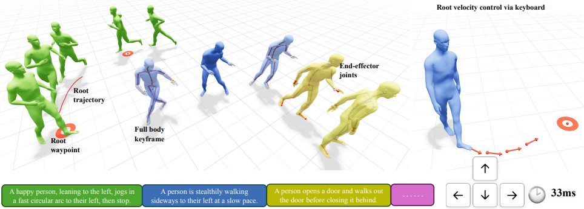

## Ardy motion prior

第一阶段基于 ARDY 模型实现可交互的 Motion Generation。

本项目在原版 ARDY 的基础上进行了扩展，保留了原有的 UI 交互控制功能，并新增了 ARDY Motion 到 DW-Pose 的转换、UI Dragging 交互控制等功能。

通过与后续的 Video Renderer 模块结合，实现从交互式 Motion Generation 到 Video Generation 的完整流程，以验证 Interactive Generative Video Model 的可行性。

本 README 基于原版 ARDY 的 README.md 修改，主要介绍扩展功能及其使用方法。

# ARDY: Autoregressive Diffusion with Hybrid Representation for Interactive Human Motion Generation

<p align="center">
  <a href="https://research.nvidia.com/labs/sil/projects/ardy/"></a>
  <a href="LICENSE"></a>
  
</p>

ARDY is an autoregressive diffusion model designed for interactive motion generation, supporting online text prompting and flexible long-horizon kinematic constraints (root paths/waypoints, full-body keyframes, and sparse joint positions/rotations) with real-time responsiveness.

This repo provides code, checkpoints, and demos to work with the pre-trained ARDY models introduced in the [SIGGRAPH paper](https://research.nvidia.com/labs/sil/projects/ardy/).

## Setup
> This repo has mainly been tested on Ubuntu Linux 22.04 with RTX 4090, nvidia-driver-575, and Python 3.11.

In a fresh Python 3.10+ environment (conda or venv), first install a build of **PyTorch** (>= 2.4) that matches your machine's CUDA, then install ARDY in editable mode with all optional features:

```bash
conda create -n ardy python=3.11 -y
conda activate ardy
# Install PyTorch for your CUDA version first — see https://pytorch.org/get-started/locally/
# For example:
pip install torch torchvision --index-url https://download.pytorch.org/whl/cu126
pip install -e ".[all]"
```

<details>
<summary>Install details: why PyTorch first, build requirements, and partial installs</summary>

- **Why install PyTorch first:** ARDY only requires `torch>=2.4`, so installing PyTorch yourself first lets you pick the CUDA build that matches your GPU/driver. The ARDY install then keeps the compatible PyTorch you already have rather than pulling a default wheel.
- **Build requirements:** the install builds the bundled motion-correction C++ extension, which requires CMake >= 3.15 and a C++17 compiler (`sudo apt install cmake build-essential` on Ubuntu).
- **Partial installs:** the optional dependency groups can also be installed individually:
  - `pip install -e .` — core model inference only
  - `pip install -e ".[demo]"` — adds the interactive demo (viser, gradio)
  - `pip install -e ".[video]"` — adds headless skeleton/mesh rendering; FFmpeg must also be on `PATH`
  - `pip install -e ".[trt]"` — adds TensorRT acceleration
- **TensorRT requirements:** the `[trt]` extra requires an NVIDIA driver >= 525 (CUDA 12-capable — the CUDA runtime itself is bundled via pip) and access to `pypi.nvidia.com` during install. On setups that don't meet these requirements, install `.[demo]` instead and select a non-TensorRT acceleration mode in the demo.

</details>

### Set up Hugging Face token for text encoder

The text encoder relies on the gated [meta-llama/Meta-Llama-3-8B-Instruct](https://huggingface.co/meta-llama/Meta-Llama-3-8B-Instruct) model, which requires:

- Your Hugging Face account has been granted access to the model page.
- You provide a Hugging Face token at runtime.

After you receive access to the Llama repo, create an access token in [Hugging Face token settings](https://huggingface.co/settings/tokens), then either log in on the command line:

```bash
hf auth login
```

or paste the token in `~/.cache/huggingface/token`. If you do not have `hf` installed, install it first:

```bash
pip install --upgrade huggingface_hub
```

### Checkpoints

ARDY checkpoints are available trained on various skeletons with differing FPS and prediction horizon length.

> Note: models will be downloaded automatically when used in the demo, so there is no need to download them manually

| Model | Skeleton | Training Data | FPS | Horizon | Release Date | Hugging Face | License |
|:-------|:-------------|:------:|:------:|:------:|:------:|:-------------:|:-------------:|
| **ARDY-Core-RP-20FPS-Horizon40** | Core | [Bones Rigplay 1](https://bones.studio/datasets#rp01) | 20 | 40 | July 10, 2026 | [Link](https://huggingface.co/nvidia/ARDY-Core-RP-20FPS-Horizon40) | [NVIDIA Open Model](https://www.nvidia.com/en-us/agreements/enterprise-software/nvidia-open-model-agreement/) |
| **ARDY-Core-RP-20FPS-Horizon8** | Core | [Bones Rigplay 1](https://bones.studio/datasets#rp01) | 20 | 8 | July 10, 2026 | [Link](https://huggingface.co/nvidia/ARDY-Core-RP-20FPS-Horizon8) | [NVIDIA Open Model](https://www.nvidia.com/en-us/agreements/enterprise-software/nvidia-open-model-agreement/) |
| **ARDY-G1-RP-25FPS-Horizon52** | Unitree G1 | [Bones Rigplay 1](https://bones.studio/datasets#rp01) | 25 | 52 | July 10, 2026 | [Link](https://huggingface.co/nvidia/ARDY-G1-RP-25FPS-Horizon52) | [NVIDIA Open Model](https://www.nvidia.com/en-us/agreements/enterprise-software/nvidia-open-model-agreement/) |
| **ARDY-G1-RP-25FPS-Horizon8** | Unitree G1 | [Bones Rigplay 1](https://bones.studio/datasets#rp01) | 25 | 8 | July 10, 2026 | [Link](https://huggingface.co/nvidia/ARDY-G1-RP-25FPS-Horizon8) | [NVIDIA Open Model](https://www.nvidia.com/en-us/agreements/enterprise-software/nvidia-open-model-agreement/) |


**Coming soon!** We are working to train a version of ARDY on Rigplay 1 with the [SOMA body model](https://github.com/NVlabs/SOMA-X) skeleton.

### [Optional] Dataset

Downloading data is only required for running the kinematically constrained generation demos.

**Bones SEED motion data**:
The kinematically constrained generation demo samples constraints from motion sequences in the [Bones SEED](https://huggingface.co/datasets/bones-studio/seed) dataset. The motion data are provided in CSV format for G1. Corresponding text descriptions are retrieved from the metadata CSV during sampling.

Please download the Bones SEED dataset and put them under the `datasets/bones-seed/` directory in the root of the repo. The directory structure should be as follows:
```
datasets/bones-seed/
  g1/csv/
  metadata/
    seed_metadata_v004.csv
```

---

## Interactive Demo

We provide an interactive demo that enables real-time humanoid character control through a combination of streaming text prompts and interactive spatial constraints. Below are some features of the interactive demo:

- Online motion generation visualized in web browser viewport
- Streaming text-to-motion
- Kinematically constrained motion generation (full body keyframes, root trajectory and waypoints, end-effector joints)
- Mouse and keyboard-based locomotion controls

### Launch Interactive Demo

```bash
python scripts/run_demo.py
```

If you plan to be frequently re-launching the demo, it can be helpful to launch the text encoder API service in the background. This way, the demo will not need to instantiate the text encoder every time it is launched. In a separate terminal, run:
```bash
python scripts/run_text_encoder_server.py
```

### Quick Start
- **Open the UI**: In your browser, go to `http://localhost:2333`. You can use Left-drag to rotate, Right-drag to pan, and Scroll to zoom to control the camera with mouse.
- **Load a model**: Choose a checkpoint from the **Model Directory** dropdown in the **Model** tab and click **Load Model**. The first load may take a few minutes if TensorRT compilation is enabled. A default checkpoint is loaded if no checkpoint is manually selected.
- **Start playback**: Press `Space` key or click **Play** button to start/stop playing the motion.
- **Text prompts**: Either click a preset in **Prompt List**, or type your own in **Prompt Text** and click **Update Text Prompt**.
- **Mouse-based locomotion control**: Press `p` to enable waypoint mode (or click the **Enable Waypoint Mode** checkbox in the **Waypoint** folder under **Generate** tab), then click in the viewport to place waypoints for locomotion control.
- **Keyboard-based velocity control**: Press `t` key to enable target-velocity control. Use arrow keys to steer: left/right rotate the direction; up/down increase or decrease the speed.
- **Kinematic constraints**: Press `z` key to sample kinematic constraints from a dataset sequence specified in **Motion file path** (in the **Constraints** folder under **Generate** tab). Use the constraint-type checkboxes to control which categories are sampled.
- **Export/load sessions**: Use the **IO** tab for basic export/load of constraints and motion.

More detailed information about the interactive demo is available in the [GUI Reference](#gui-reference) section.

### GUI Reference

<details>
<summary>Click to expand for detailed GUI usage</summary>

#### Hotkeys

| Key | Action |
|-----|--------|
| Space | Toggle play/pause |
| j | Previous frame |
| k | Next frame |
| r | Reset automatic camera to follow current frame |
| t | Toggle target velocity control and arrow key overlay |
| p | Toggle waypoint control mode |
| z | Sample kinematic constraints from specified motion file |
| Arrow keys | Control target velocity direction/speed (when target velocity control is enabled) |
| h | Show / hide keyboard shortcut overlay |

#### Tab: Playback

- **Native FPS** - The motion FPS of the loaded model.
- **Enable Auto-Replan** - If disabled, motion will not be automatically generated and stop at the last generated frame.

#### Tab: Text

- **Prompt List** - Preset prompt buttons containing example prompts. Clicking directly updates the active text prompt and embedding. You can select the text prompts on the fly and can also input your own text prompt using the **Prompt Text** field.
- **Prompt Text** - Enter a text prompt here; it will not take effect until the Update button is clicked.
- **Update Text Prompt** - Click to update the active text prompt and embedding.

#### Tab: Generate

- **Restart** - Clear all motion and restart generation from the first frame.
- **Restart From Now** - Clear motion after current frame and continue generation from the current frame.
- **Clear All Constraints** - Clear all kinematic constraints.
- **Initial Body Transform** - A gizmo to control initial root position and orientation.
- **Constraints**
  - Motion file path: path to a CSV (G1) motion file from `datasets/bones-seed/`. The kinematic constraints will be sampled from this motion file.
  - Random Motion File button: pick a random motion file from `datasets/bones-seed/` matching the loaded skeleton and populate the Motion file path field.
  - Crop to 10s: if enabled, randomly crop the loaded motion to 10 seconds if the motion is longer than 10 seconds.
  - Constraints types checkboxes [full body, hands, feet, hands+feet, 2D waypoints, 2D trajectory]: if enabled, sample constraints for the selected category.
  - Max keyframe number: maximum number of keyframe constraints allowed for sampling
  - Continue from current frame: if enabled, sample new constraints without restarting; otherwise clear motion history before generation.
  - Sample Constraints button (hotkey: `z`): If pressed, the kinematic constraints will be sampled from the specified motion file. Note that the kinematic constraints sampling only supports the G1 skeleton which is included in the Bones Seed dataset.
- **Waypoint** (mouse-based locomotion control)
  - Waypoint mode (hotkey: `p`): toggle mouse-click-based waypoint control mode
  - Dense root: if enabled, use interpolation to generate dense trajectory constraints from waypoints
  - Waypoint interval: time interval between current frame and the waypoint keyframe, measured in number of frames.
- **Target Velocity** (keyboard-based velocity control; works better with the **Over-the-shoulder** auto camera enabled)
  - Enable checkbox: enable target velocity control.
  - Target root velocity: target root velocity in XZ plane.
  - Use target heading: if enabled, use root position + orientation as constraints; if disabled, only use root position as constraints.
- **Post Process**
  - Enable Post-Processing: apply optional motion correction to reduce foot skating and improve constraint following (slower; disabled by default).
  - Root Margin: margin for root position correction.
  - Contact Threshold: threshold for foot contact detection.

#### Tab: Visualize

- **Show Foot Contacts** - Color the foot joints purple on frames where the model predicts the foot to be in contact with the ground. Only visible when **Show Skeleton** is enabled.
- **Show Hand+Foot Orientations** - Overlay rotation-axis gizmos on the hand/wrist and foot joints, for both the generated motion and any end-effector keyframes in the timeline. Useful for verifying that orientation constraints are being followed.
- **Show Reference Motion** - Display the reference motion specified in **Motion file path** as a red semi-transparent mesh character
- **Hide Distant Constraints** - If enabled, constraints outside the future cropping range specified in **Future Crop Length** are hidden
- **Auto Camera** - A dropdown list to select from three auto camera types that updates according to current frame's human body pose.

#### Tab: Model

- **Acceleration Mode** - Choose TensorRT, torch.compile, or none
- **Text Encoder** - Set device + precision for the LLM2Vec text encoder. Options: `cuda / bfloat16` (default, fastest, ~14 GB VRAM), `cuda / float32` (VRAM demanding), `cpu / bfloat16`, `cpu / float32` (slower prompt encoding but requires less VRAM).
- **TRT Export Settings** - Min/opt/max tokens and export button. These settings are used to configure the exportation of the TensorRT engines for the denoiser and decoder and may slightly affect the generation speed.
- **History Crop Length** - Maximum number of history frames input to the model (min: patch size, max: FPS x 10s - generation horizon, step size: patch size, default: min). Smaller history crop length facilitates faster adaptation to new prompts and kinematic constraints, while larger history crop length allows for longer context which helps complex semantic motion generation and smoother transitions.
- **Future Crop Length** - Number of future frames beyond generation horizon for constraint input (min: 0, max: FPS x 10s - generation horizon, step size: patch size, default: max)
- **Replan Buffer Size** - How many frames of replan buffer to use. Ensure that the generation time is less than the (replan buffer + 1) frames playback time.
- **Replan Trigger Threshold** - When remaining generated-but-unplayed frames <= this threshold, trigger replan.

#### Tab: IO

- **Session Export/Load** - Export/load the full session (motion and/or constraints) to/from a file.
- **Export Motion NPZ** - Save generated motion and its prompt timeline in the standard format accepted by `scripts/visualize.py` and `scripts/export_video.py`.
- **DW-Pose Video** - Export generated motion directly as a front-facing, full-body pose animation on black; choose dimensions, hide the head joint, or follow the character.
- **Root Constraints** - Load/save root constraints to a file.
- **Scene** - Load a scene file and adjust mesh transform/translation.
- **Capture Viewport Image** - Capture the current viewport image and save it to a file.

</details>

### Model Integration in Demo

The interactive demo is a good reference for how ARDY can be used autoregressively for realtime applications. The key entry points are:

- **Loading:** [`load_model()`](ardy/model/load_model.py) resolves a checkpoint, builds the model, and attaches the LLM2Vec text encoder (built separately via `load_text_encoder()` so it can be reused across models). Models are referenced by nickname — a skeleton name (`"core"`, `"g1"`, `"soma"`, resolving to that skeleton's default horizon) or skeleton+horizon (`"core8"`, `"g152"`, `"soma60"`) — or by full name (`"ARDY-Core-RP-20FPS-Horizon40"`); see [`ardy/model/registry.py`](ardy/model/registry.py). The demo wires this up in [`ModelLoadingMixin.load_model`](scripts/interactive_demo/loading.py).
- **Generation:** the model runs autoregressively via [`Ardy.autoregressive_step()`](ardy/model/ardy_model.py) — text embeddings and optional kinematic constraints (`motion_mask`/`observed_motion`) in, motion frames out. See it called each step in [`GenerationMixin._generate_step`](scripts/interactive_demo/generation.py), which shows how to encode the text prompt, assemble history + constraint masks, and decode the output back to joint positions with `motion_rep.inverse(...)`.

---

## Command-Line Generation

For non-interactive / batch generation, [`scripts/generate.py`](scripts/generate.py) generates motion from a text prompt and writes it to disk (`.npz`; plus a MuJoCo-qpos `.csv` for G1). Generated files are written to the `outputs/` folder by default.

```bash
# Simplest: 5s of motion with the default model, written to outputs/output.npz
python scripts/generate.py "A person walks in a circle."

# Choose a model + length, and fix the seed for reproducible output (writes outputs/jump.npz)
python scripts/generate.py "A person jumps." --model core --duration 8.0 --seed 0 --output jump

# Multiple samples (writes a folder outputs/waves/ with waves_00.npz, waves_01.npz, ...)
python scripts/generate.py "A person waves." --model g1 --num_samples 4 --output waves

# Switch prompts at 3s, 6s, and 9s using the responsive core8 model
python scripts/generate.py "A person walks." --model core8 --duration 12 \
    --prompt-switch 3 "A person runs." \
    --prompt-switch 6 "A person sidesteps." \
    --prompt-switch 9 "A person walks backward." \
    --output prompt_switch
```

Each `.npz` contains the generated motion — `posed_joints` (world-space joint positions, `[T, J, 3]`), local/global joint rotations, root positions, and foot contacts — plus the `fps` and the prompt `text`.
Prompt-switched files additionally contain `prompt_texts`, `prompt_start_frames`, and `prompt_end_frames` (exclusive). The browser visualizer and `--show-text` video overlay display the prompt active at each frame.

To play back a generated motion in the browser (same viser viewport as the interactive demo), use [`scripts/visualize.py`](scripts/visualize.py):

```bash
python scripts/visualize.py outputs/output.npz   # single file
python scripts/visualize.py outputs/waves        # folder written with --num_samples > 1
```

then open `http://localhost:2334`. The skeleton (core / g1 / soma) is detected from the file; the viewer offers play/pause, a frame slider, mesh/skeleton toggles, and a sample dropdown for multi-sample folders.

Most useful flags:

| Flag | Meaning |
|------|---------|
| `--model` | Model nickname `core`/`g1` (optionally with horizon, e.g. `core8`) or full folder name. Default: `core`. |
| `--duration` | Length in seconds (default 5.0). |
| `--prompt-switch SECONDS PROMPT` | Change the prompt at a token-aligned time; repeat the flag for multiple switches. Currently cannot be combined with `--constraints`. |
| `--num_samples` | Number of samples; when >1, writes a numbered folder. |
| `--seed` | Fix the random seed for reproducible output. |
| `--output` | Output stem (single sample → one file; multiple → a folder). Bare names go under `outputs/`; pass a path (e.g. `results/jump`) to write elsewhere. |
| `--history_frames` | History visible to each autoregressive step. Defaults to one motion token, matching the demo (4 frames for Core); overrides must be positive multiples of the model's token size. |
| `--cfg_weight` | Classifier-free guidance scale. Pass one value for text guidance only, or two values for text and constraint guidance (default: `2.0 2.0`). |
| `--constraints` | Path to a saved kinematic-constraint list. |
| `--postprocess` / `--no-postprocess` | Enable or disable motion post-processing to reduce foot skating and hit constraints. Default: off, matching the demo. Always disabled for G1. |

> Tip: if you generate repeatedly, start the standalone text-encoder service in the background first (`python scripts/run_text_encoder_server.py`) so each run connects to it instead of loading the LLM2Vec model in-process every time.

## Video Export

There are two video paths:

1. **Headless skeleton, mesh, or DW-Pose video** — deterministic, scriptable, and does not need a browser or GPU.
2. **Viewport video** — available in the motion editor below; captures the current browser camera and can include the skinned mesh, skeleton, or both.

For headless skeleton, mesh, and DW-Pose MP4s:

~~~bash
python scripts/export_video.py outputs/output.npz
python scripts/export_video.py outputs/output.npz --render-mode dwpose
python scripts/export_video.py outputs/output.npz --render-mode dwpose --hide-head \
    --follow-root --width 720 --height 1280 --output videos/pose_portrait.mp4
python scripts/export_video.py outputs/output.npz \
    --render-mode mesh --face-front --follow-root \
    --output videos/output_mesh.mp4
python scripts/export_video.py outputs/output.npz \
    --output videos/output.mp4 \
    --azimuth 120 --elevation 20 --follow-root \
    --width 1920 --height 1080
~~~

The input is the NPZ written by scripts/generate.py. The default output is beside the input with an .mp4 extension. Mesh mode uses the packaged Core or SOMA skinned body, or the articulated G1 STL geometry. It deforms and rasterizes the mesh directly on CPU, so no browser, display server, or GPU is needed. The exporter uses FFmpeg (available on `PATH`), streams encoded frames, and accepts MP4 or WebM output.

Useful camera/render arguments:

| Flag | Meaning |
|------|---------|
| --render-mode skeleton / mesh / dwpose | Render the 3D skeleton, animated mesh, or a black-background DW-Pose-style body animation. |
| --hide-head | DW-Pose: omit the head point and its connecting edge; keep the neck/body. |
| --face-front / --no-face-front | All modes: align to the first exported pose or use world-space angles. Default: on for DW-Pose, off for skeleton/mesh. |
| --padding | DW-Pose: margin on each side as a fraction of image size (default 0.08). |
| --azimuth / --elevation | Orbit camera angles in degrees. |
| --distance / --fov | Explicit camera distance and vertical field of view; distance auto-fits by default. |
| --target X Y Z | Use a fixed look-at point. |
| --follow-root | Follow the character along a long path. |
| --start-frame / --end-frame | Render an exclusive frame range. |
| --fps | Playback FPS override; defaults to the motion's native FPS. |
| --trail-seconds | Opt into a root trajectory trail of this duration; disabled by default. |
| --no-grid / --show-text | Hide the ground grid or opt into the prompt/time overlay. |
| --mesh-color R G B | Set the mesh's base RGB color. |
| --mesh-max-faces | G1-only CPU face budget; increase it for more detail at slower render speed. |

DW-Pose mode projects the existing 3D motion into 2D; it does not run a pose detector or need additional model weights. It uses the usual body colors, circular joints, and oval limbs on pure black. Overlapping limbs and joints use their camera-space depth, so the nearer leg or arm stays in front at crossings. Core and SOMA map to shoulders, elbows, wrists, hips, knees, and ankles, with a shoulder-midpoint neck and an optional `Head` joint used as a head proxy (not an estimated nose). Face landmarks, eyes/ears, fingers, toes, and extra spine joints are omitted. G1 maps its corresponding limb joints and omits the unavailable head.

Skeleton and mesh exports also support `--face-front`. This starts with a level front view of the first exported frame and keeps the viewing angle fixed for the rest of the clip. `--azimuth` then adds an offset to that front view; `--elevation` overrides the default zero elevation. It works with `--follow-root` and `--start-frame`. Without `--face-front`, skeleton and mesh retain their default 45° azimuth / 15° elevation.

The default DW-Pose camera faces the hip heading at the **first exported frame**, at zero elevation. Its orientation stays fixed afterward, preserving turns, rolls, and sideways movement. `--azimuth` adds an offset to that initial front view; `--no-face-front --azimuth 90` selects an absolute world view. The camera automatically fits every source joint over the selected frame range, with a constant distance and padding to keep jumps and extended limbs in frame in landscape or portrait output. `--follow-root` centers the moving character without rotating the camera. A manually supplied `--distance` overrides auto-fit and may crop the pose. `--hide-head` leaves the framing unchanged. DW-Pose output has no grid, text, or trajectory overlays.

MP4 requires FFmpeg with `libx264`; WebM requires `libvpx-vp9` (the cluster's current FFmpeg lacks VP9, so use MP4 there).

DW-Pose's default output is `INPUT_dwpose.mp4`, preserving the usual `INPUT.mp4` render. FPS defaults to the NPZ's native rate; `--fps` changes playback speed without resampling. In the interactive demo, open **IO → DW-Pose Video**, choose dimensions and **Hide Head Joint** / **Follow Character**, then click **Export DW-Pose Video**. It exports a snapshot in the background to the server path, with numbered files for multiple samples.

Run python scripts/export_video.py --help for the complete interface.

## Interactive Motion Editor

Launch the standalone editor with any generated ARDY NPZ:

~~~bash
python scripts/edit_motion.py outputs/output.npz
# Then open http://localhost:2335
~~~

python scripts/edit_motion.py outputs/Editing workflow:

1. Pause on the frame that should hit the desired pose.
2. Click a blue joint in the 3D view, or select its name in **Selected joint**.
3. Drag the orange translation gizmo. The joint's ancestor chain is solved with inverse kinematics, so bones stay connected and keep their exact lengths.
4. Adjust **Body influence**:
   - **Limb** changes the nearby limb chain and preserves most of the body.
   - **Body** lets torso joints help.
   - **Whole body** uses the complete ancestor chain; **Whole-body root reach** can additionally translate the root for otherwise unreachable targets.
5. Adjust **Ease in**, **Hold**, and **Ease out** to control how the edit develops over time. These use a smoothstep envelope and solve every affected frame as one batch.
6. Use **Commit**, **Undo**, or **Reset**, then save a new NPZ. Unknown source fields are retained and all FK-derived position/rotation fields are updated.

The editor is deterministic and model-independent, so it is responsive on CPU and does not require checkpoint loading. It directly changes the motion file using temporally blended CCD inverse kinematics. For a mesh video, set **Show mesh** / **Show skeleton**, arrange the browser camera, and click **Export current viewport**.

The editor limits numerical libraries to one compute thread by default. This avoids OpenMP thread-exhaustion errors on shared login nodes and is typically faster for the small batched IK solve. To opt into more threads, launch it with `ARDY_EDITOR_THREADS=4 python scripts/edit_motion.py ...`.

The default output names are INPUT_edited.npz and INPUT_edited.mp4. Use --output and --port to change them:

~~~bash
python scripts/edit_motion.py outputs/output.npz \
    --output results/hand_raise_edited.npz \
    --port 2440
~~~

---

## Related Humanoid Work at NVIDIA
ARDY is closely related to several works from NVIDIA on humanoid motion and control:
* [Kimodo](https://github.com/nv-tlabs/kimodo) - human motion generation model specializing in controllable _offline_ motion authoring.
* [MotionBricks](https://nvlabs.github.io/motionbricks/) - real-time motion generation framework that specializes in fast and robust motion in-betweening.
* [GEAR SONIC](https://github.com/NVlabs/GR00T-WholeBodyControl) - humanoid behavior foundation model for physical robots. ARDY can be used as a planner to generate motions given to SONIC.

---

## Citation

If you use this code in your research, please cite:

```bibtex
@article{zhao2026ardy,
  title   = {ARDY: Autoregressive Diffusion with Hybrid Representation for Interactive Human Motion Generation},
  author  = {Zhao, Kaifeng and Petrovich, Mathis and Zhang, Haotian and Wang, Tingwu and Tang, Siyu and Rempe, Davis},
  journal = {ACM Transactions on Graphics (TOG)},
  year    = {2026},
  volume  = {45},
  number  = {4},
  articleno = {86},
  doi     = {10.1145/3811284}
}
```

## License

This codebase is licensed under [Apache-2.0](LICENSE). Note that model checkpoints and data are licensed separately as indicated on the HuggingFace download pages.

This project will download and install additional third-party open source software projects. Review the license terms of these open source projects before use.

## Acknowledgments

This project builds upon excellent open-source projects:
- [Viser](https://github.com/nerfstudio-project/viser) for interactive 3D motion generation demo
- [LLM2Vec](https://github.com/McGill-NLP/llm2vec) for text encoding

## Contact

For questions or issues, please open an issue on this repository or reach out directly to the authors.

---
